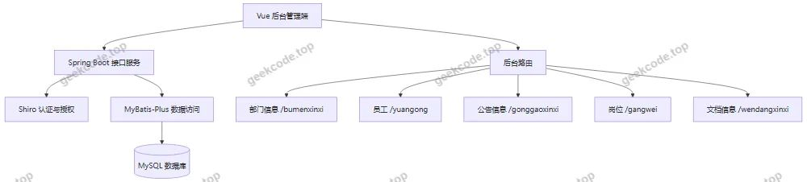
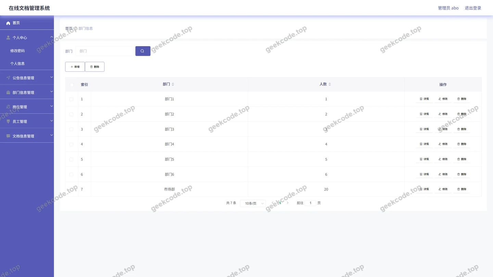
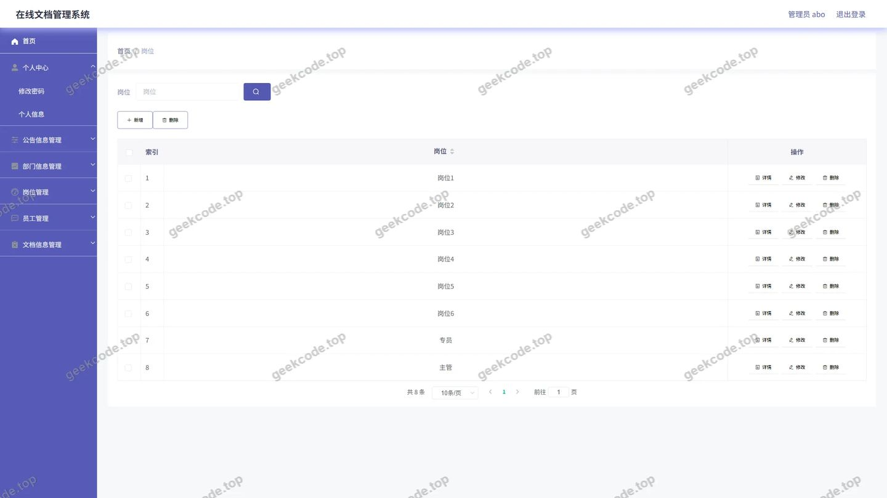
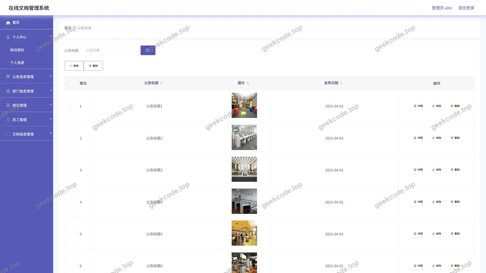
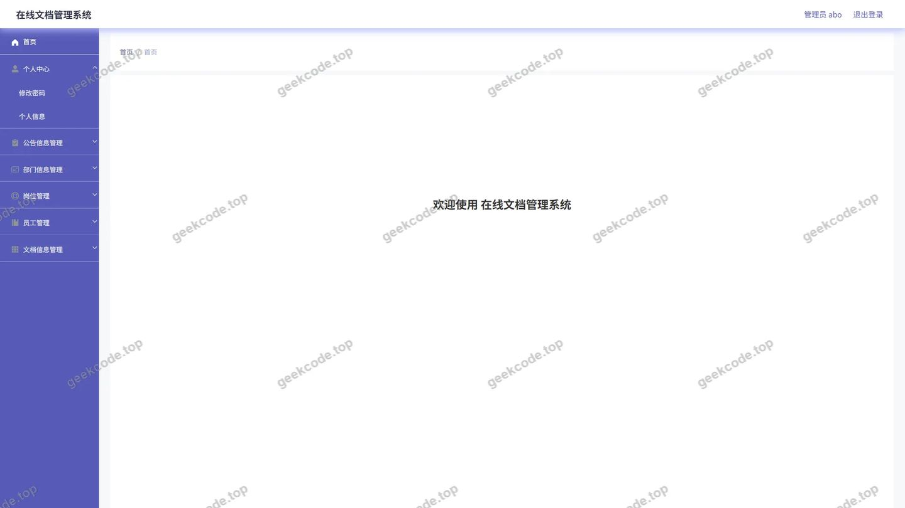
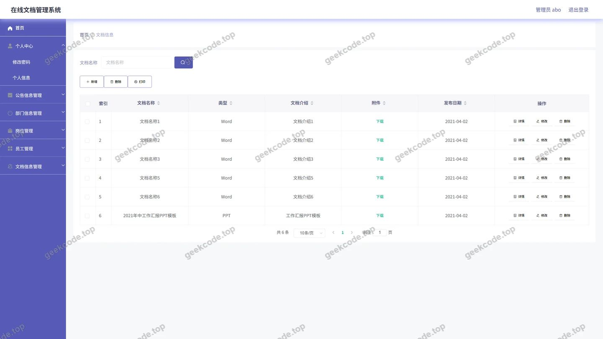
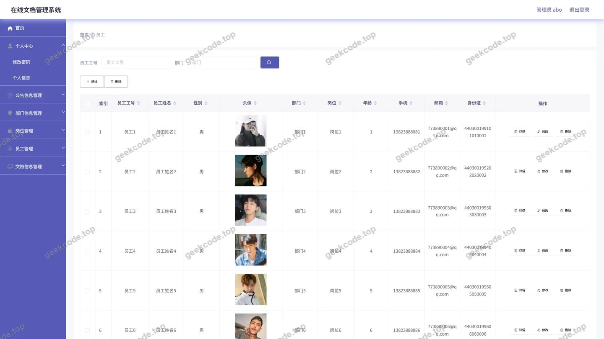

# 基于SpringBoot的在线文档管理系统的设计与实现

> 🎓 **计算机毕业设计 · 基于SpringBoot的在线文档管理系统的设计与实现**
>
> 本仓库只放**项目介绍 + 运行截图**（截图是站点带水印的原图，存在仓库 `images/` 里）。
>
> 👉 **完整可运行源码 / 数据库脚本 / 部署文档：[点我获取](https://geekcode.top/archives/%E5%9F%BA%E4%BA%8ESpringBoot%E7%9A%84%E5%9C%A8%E7%BA%BF%E6%96%87%E6%A1%A3%E7%AE%A1%E7%90%86%E7%B3%BB%E7%BB%9F%E7%9A%84%E8%AE%BE%E8%AE%A1%E4%B8%8E%E5%AE%9E%E7%8E%B0?utm_source=github)**
>
> 💬 咨询微信：**ir9372**　|　🌐 更多项目：[极客代码 geekcode.top](https://geekcode.top/?utm_source=github)
>
> 📌 项目详情页：<https://geekcode.top/archives/%E5%9F%BA%E4%BA%8ESpringBoot%E7%9A%84%E5%9C%A8%E7%BA%BF%E6%96%87%E6%A1%A3%E7%AE%A1%E7%90%86%E7%B3%BB%E7%BB%9F%E7%9A%84%E8%AE%BE%E8%AE%A1%E4%B8%8E%E5%AE%9E%E7%8E%B0?utm_source=github>

<table><td width="230" align="center"> <b>扫码加微信 ir9372</b></td><td valign="middle">📦 源码 = 项目介绍 + 全部运行截图 + 数据库 + 部署文档 👉 点上方任意截图，直接跳到 <b>极客代码 geekcode.top</b> 详情页</td></table>

---

<h1>基于SpringBoot的在线文档管理系统的设计与实现</h1>
<h2>项目概述</h2>

本项目面向组织内部文档与公告管理场景，基于 Spring Boot 与 MyBatis-Plus 构建后台管理系统，使用 Shiro 实现登录认证与访问控制，前端采用 Vue 集成方式。系统后台提供部门信息、员工、岗位、公告信息、文档信息等管理页面，支持管理员统一维护部门、员工、岗位等基础数据，并对公告与文档信息进行集中管理。适用于需要内部资料归档、公告发布、部门与员工信息维护的管理人员。整体架构以 MySQL 作为数据存储，后端通过控制器提供接口，前端路由与后台页面相对应，形成以管理员为核心的在线文档管理后台。

<h2>技术架构</h2>

项目采用前后端集成式架构，后端基于 Spring Boot 提供接口服务，前端基于 Vue 构建后台管理页面。系统通过 Shiro 完成登录认证与后台访问控制，通过 MyBatis-Plus 完成业务数据持久化，数据库使用 MySQL。

后端接口控制器包括 BumenxinxiController、YuangongController、GonggaoxinxiController、GangweiController、WendangxinxiController、UserController、ConfigController、FileController、CommonController。其中业务控制器对应部门信息、员工、公告信息、岗位、文档信息等功能，UserController 提供用户相关接口能力，ConfigController 提供配置相关接口能力，FileController 提供文件相关接口能力，CommonController 提供公共接口能力。

数据库设计围绕组织内部文档管理业务展开，核心业务对象包括部门信息、员工、岗位、公告信息、文档信息。系统通过 MyBatis-Plus 对业务实体进行数据访问，具体表字段与表关系未在提供上下文中展示。

核心技术选型理由如下：Spring Boot 用于快速搭建后端服务并集成常用组件；MyBatis-Plus 用于简化数据库访问与业务对象持久化；Shiro 用于实现后台登录认证与访问控制；MySQL 用于存储部门、员工、岗位、公告、文档等业务数据；Vue 用于构建后台管理界面，并通过路由与后端接口协同完成页面访问。

<h2>功能模块</h2>

前台用户端：项目上下文未提供前台路由、前台导航菜单和个人中心菜单，因此系统不包含前台用户端功能模块，整体功能集中在后台管理端。

后台管理端主要功能模块如下：

<ul>
<li>管理员登录：后台登录页用于管理员身份登录，系统通过 Shiro 完成认证与访问控制。</li>
<li>后台首页：管理员登录后的系统主界面，用于进入后台各管理模块。</li>
<li>部门信息：对应后台路由 /bumenxinxi 与 BumenxinxiController，用于维护组织内部部门信息。</li>
<li>员工：对应后台路由 /yuangong 与 YuangongController，用于维护员工信息。</li>
<li>岗位：对应后台路由 /gangwei 与 GangweiController，用于维护岗位信息。</li>
<li>公告信息：对应后台路由 /gonggaoxinxi 与 GonggaoxinxiController，用于维护公告信息。</li>
<li>文档信息：对应后台路由 /wendangxinxi 与 WendangxinxiController，用于维护文档信息。</li>
<li>用户接口能力：后端存在 UserController，提供用户相关接口能力，后台路由与截图未展示独立用户管理界面。</li>
<li>配置接口能力：后端存在 ConfigController，提供系统配置相关接口能力。</li>
<li>文件接口能力：后端存在 FileController，提供文件相关接口能力。</li>
<li>公共接口能力：后端存在 CommonController，提供公共接口能力。</li>
</ul>
<h2>用户角色与权限</h2>

系统可见角色为管理员 admin。管理员通过后台登录页进入系统，在后台首页及各业务管理页面中开展管理操作。管理员可访问的功能模块包括后台首页、部门信息、员工、公告信息、岗位、文档信息。后台访问控制由 Shiro 实现，未登录用户不能直接进入后台管理页面。

项目上下文未提供前台路由、前台导航菜单和个人中心菜单，因此不存在可见前台用户端角色与前台用户功能权限。后端代码中包含 UserController，但后台路由与截图未展示独立用户管理界面，本文档按可见后台界面与路由描述管理员权限。

<h2>项目特色与创新点</h2>

本项目的特色在于围绕组织内部文档管理场景构建一体化后台管理能力，将部门信息、员工、岗位、公告信息、文档信息纳入统一后台进行维护，减少内部资料、公告与组织人员信息分散管理带来的不便。

系统采用 Spring Boot 与 MyBatis-Plus 组合，后端结构清晰，业务控制器与路由对应关系明确，便于开发与维护。Shiro 的引入为后台登录与访问控制提供基础安全保障，使系统具备管理员身份认证能力。Vue 集成式前端与 Spring Boot 后端接口配合，形成后台管理端页面与业务接口之间的协同运行模式。

项目重点解决的是内部文档、公告、部门、员工、岗位等信息的集中管理问题，适用于以管理员后台操作为核心的在线文档管理场景。

<h2>部署环境</h2>

运行本项目需要准备 Java 运行环境、MySQL 数据库、Node.js 前端构建环境以及 Maven 依赖管理工具。前端后台管理页面基于 Vue 集成方式构建，需要 Node.js 环境完成前端依赖安装与构建。后端基于 Spring Boot 运行，需要 Java 运行环境与 Maven 管理项目依赖。数据库使用 MySQL，需要创建对应数据库并配置连接信息。

项目运行后，通过浏览器访问后台管理页面，管理员登录后可进入后台首页及部门信息、员工、公告信息、岗位、文档信息等管理模块。上下文未提供具体 JDK、MySQL、Node.js 版本号，部署时应与项目依赖和前端构建环境保持一致。

<h2>五、技术特性</h2>
<ul>
<li>前后端集成部署，前端资源打包至后端 static 目录</li>
<li>使用 MyBatis-Plus 简化数据访问层开发</li>
<li>集成 Shiro 权限框架实现角色权限控制</li>
</ul>
<h2>六、功能模块截图</h2>
<h3>后台管理端</h3>
<h4>后台-部门信息</h4>

<h4>后台-岗位</h4>

<h4>后台-公告信息</h4>

<h4>后台首页</h4>

<h4>后台-登录</h4>

<h4>后台-文档信息</h4>

<h4>后台-员工</h4>

---

## 获取完整源码

| 项目 | 说明 |
| --- | --- |
| 项目名 | 基于SpringBoot的在线文档管理系统的设计与实现 |
| 运行截图 | 本文 8 张（站点带水印原图，仓库 `images/` 目录） |
| 完整源码 | [https://geekcode.top/archives/%E5%9F%BA%E4%BA%8ESpringBoot%E7%9A%84%E5%9C%A8%E7%BA%BF%E6%96%87%E6%A1%A3%E7%AE%A1%E7%90%86%E7%B3%BB%E7%BB%9F%E7%9A%84%E8%AE%BE%E8%AE%A1%E4%B8%8E%E5%AE%9E%E7%8E%B0?utm_source=github](https://geekcode.top/archives/%E5%9F%BA%E4%BA%8ESpringBoot%E7%9A%84%E5%9C%A8%E7%BA%BF%E6%96%87%E6%A1%A3%E7%AE%A1%E7%90%86%E7%B3%BB%E7%BB%9F%E7%9A%84%E8%AE%BE%E8%AE%A1%E4%B8%8E%E5%AE%9E%E7%8E%B0?utm_source=github) |
| 咨询微信 | **ir9372**（备注：jingpin-yuanma） |
| 更多项目 | [极客代码 geekcode.top](https://geekcode.top/?utm_source=github) |

> 需要源码、部署、改配置、跑不起来等问题，加微信 ir9372 沟通，说明项目名即可。
